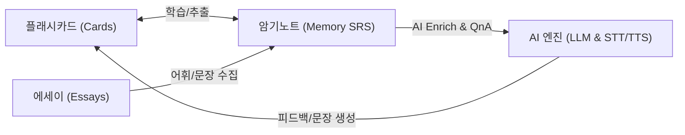
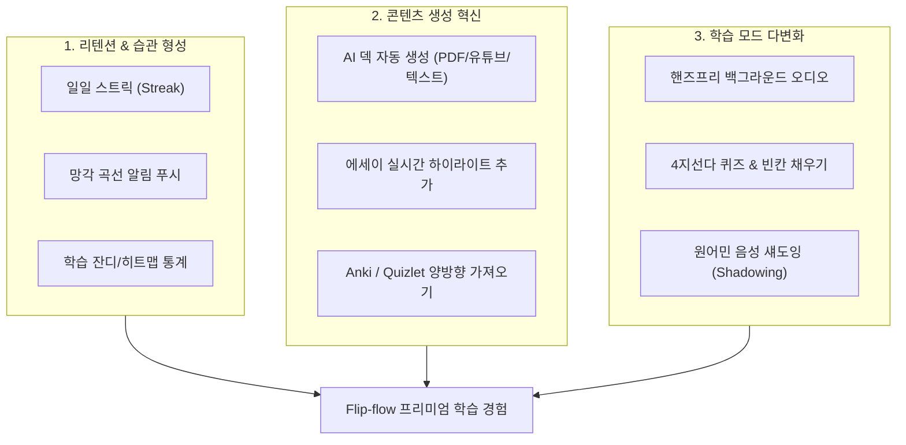
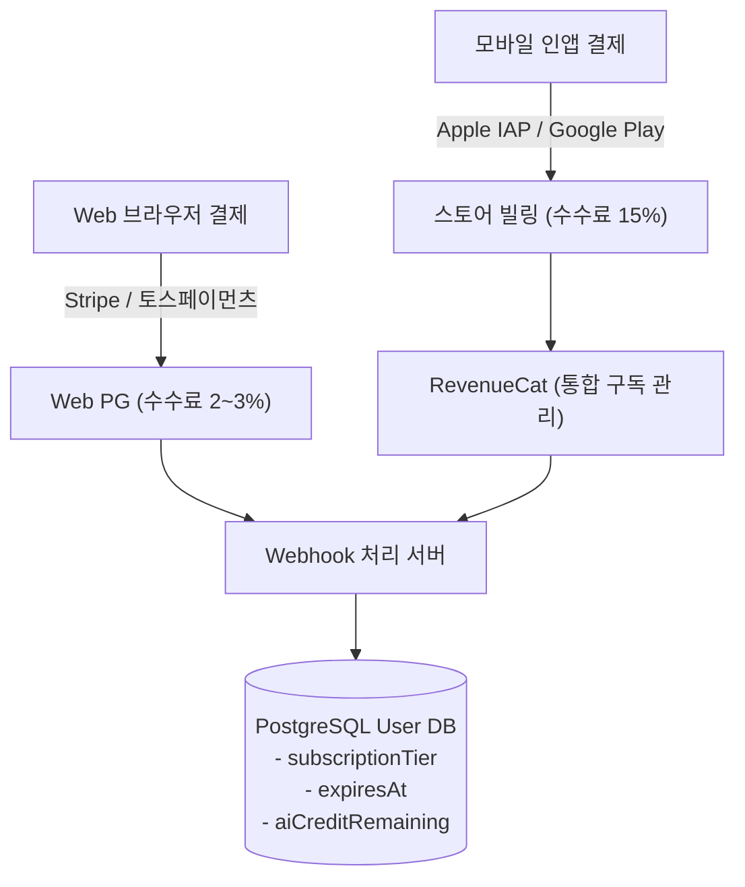
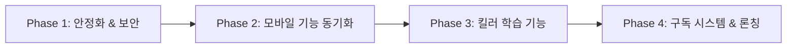

# 🚀 Flip-flow 서비스 개선 및 유료화(Monetization) 전략 보고서

> **작성 일자**: 2026년 10월 30일  
> **대상 서비스**: Flip-flow (웹 & 모바일 크로스 플랫폼 지능형 학습 도구)  
> **문서 목적**: 현재 서비스 아키텍처 및 구현 현황을 진단하고, 사용자에게 압도적으로 우수한 학습 경험을 제공하기 위한 기능 개선 과제와 지속 가능한 유료 구독 비즈니스 모델을 정의합니다.

---

## 1. 개요 및 현재 상태 진단 (Executive Summary)

**Flip-flow**는 *"복잡함은 덜어내고, 암기의 흐름(Flow)만 남기다"*라는 슬로건 아래, **플래시카드 학습**, **에세이 리딩/작성**, **SRS 암기노트(Spaced Repetition)**, **AI 발음 및 어휘 학습**을 유기적으로 연결한 올인원 학습 플랫폼입니다.

### 1.1 현재 구현된 핵심 강점
- **부드러운 카드 인터랙션**: Framer Motion 기반 3D 카드 플립, 스와이프 슬라이드 제스처, 앞/뒤 반전 학습.
- **SRS(간격 반복) 알고리즘 탑재**: SM-2 변형 기반 4단계(AGAIN, HARD, GOOD, EASY) 복습 큐잉.
- **에세이-학습 통합**: Markdown 및 KaTeX(수식) 렌더링, 에세이 문맥에서 단어를 추출해 암기노트로 연결.
- **크로스 플랫폼 기반**: Next.js 16 (App Router) 웹과 React Native (Expo) 모바일 앱 듀얼 지원.
- **다국어(i18n) 및 테마**: 한국어/영어 로케일 및 다크/라이트 모드 지원.

---

## 2. 핵심 개선점 및 문제점 진단 (Gap Analysis)

### 2.1 [보안 및 안정성] 비인가 API 엔드포인트 및 API 오남용 취약점
> [!CAUTION]
> **인증 세션 검증 누락으로 인한 비용 폭탄 위험**
> - `src/app/api/pronunciation/route.ts` 및 `src/app/api/sentences/route.ts`에 NextAuth `auth()` 세션 검증이 누락되어 있습니다.
> - 비인가 사용자가 스크립트로 이 엔드포인트를 무한 호출할 경우, `OPENAI_API_KEY` 과금이 급증할 수 있습니다.
> - **개선 과제**: 모든 AI 엔드포인트에 즉시 세션 인증을 적용하고, IP/사용자 ID 기반 **Rate Limiting**(Upstash Redis 또는 Cloudflare WAF)을 도입해야 합니다.

### 2.2 [데이터 모델] 독립 `Deck` 엔티티 부재 및 학습 로그 결핍
- **독립 Deck 테이블의 부재**:
  현재 `prisma/schema.prisma`에서 `Card.category` 문자열 필드로만 덱을 구분하고 있습니다. 이로 인해 덱별 설명, 썸네일, 태그, 공개/비공개 설정, 다운로드 수, 학습 옵션 등의 메타데이터 확장이 불가능합니다.
- **학습 이력(Study History) 로그 부재**:
  사용자가 오늘 몇 장의 카드를 학습했는지, 정답률이 얼마인지, 연속 며칠 동안 공부했는지(Streak)를 기록하는 로그 테이블이 없습니다. 성취감을 주는 통계 대시보드를 구축하려면 일별 학습 로그(`StudyLog`) 모델이 필수적입니다.

### 2.3 [플랫폼 격차] 웹과 모바일 간 기능 불일치 (Feature Disparity)
- **모바일 암기노트(Memory) 부재**:
  백엔드 API(`src/app/api/mobile/memory`)는 완성되어 있으나, 모바일 앱(`mobile/app/(tabs)/_layout.tsx`)에는 암기노트 탭과 SRS 복습 세션 화면이 구현되어 있지 않습니다.
- **모바일 발음 평가(STT) 미구현**:
  웹은 Web Speech API로 발음 인식 및 유사도 분석을 제공하지만, 모바일 앱은 시스템 TTS(듣기)만 지원하고 사용자 음성 인식 및 발음 피드백이 누락되어 있습니다.
- **오프라인 모드(Offline-First) 부재**:
  지하철, 비행기 등 이동 중에도 단어장을 학습할 수 있는 로컬 캐싱(Expo SQLite / WatermelonDB) 및 네트워크 복구 시 양방향 동기화 메커니즘이 필요합니다.

### 2.4 [AI 효율성 및 비용] 일원화된 고비용 LLM 호출
- 현재 모든 텍스트 작업에 `gpt-4.1`을 단일 호출하고 있습니다 (`src/lib/openai.ts`).
- 단순 단어 번역이나 초급 예문 생성까지 고비용 모델을 사용하면 사용자 증가 시 인프라 비용 부담이 기하급수적으로 늘어납니다.
- **모델 티어링**: 단순 어휘 정의는 경량/고속 모델(Gemini Flash-Lite, GPT-4o-mini) 또는 공용 사전 DB 캐시를 활용하고, 심층 발음 교정이나 에세이 첨삭에만 고성능 모델을 매핑해야 합니다.

---

## 3. 우수한 서비스를 제공하기 위한 5대 UX 전략

사용자가 다른 플래시카드 앱(Anki, Quizlet, RemNote) 대신 **Flip-flow**를 계속 찾고 매일 머무르게 하기 위한 5가지 핵심 경험입니다.

### 3.1 스마트 콘텐츠 수집 및 AI 자동 덱 생성
- **1-Click AI Deck Generator**:
  긴 지문, 뉴스 기사 링크, PDF, 또는 유튜브 자막을 붙여넣으면 AI가 핵심 어휘와 중요 구문을 추출하여 `앞면(단어/표현) - 뒷면(문맥 의미 + 예문)` 카드를 10초 만에 덱으로 생성.
- **에세이 텍스트 하이라이트 팝업**:
  에세이를 읽다가 마우스로 텍스트를 드래그하면 툴팁 팝업이 떠서 `[AI 뜻풀이]` 및 `[암기노트에 즉시 추가]`가 한 번에 이루어지는 유기적 워크플로우 구축.
- **생태계 호환성**:
  기존 학습자들이 보유한 Anki(.apkg), Quizlet, CSV 파일을 손실 없이 한 번에 가져오는 대량 마이그레이션 도구 제공.

### 3.2 학습 모드 다변화 (Multimodal Study)
- **핸즈프리(Hands-free) 오디오 모드**:
  출퇴근길 지하철이나 운동/운전 중 화면을 끈 상태(Background Audio)에서 `앞면 읽어주기 -> 3초 대기 -> 뒷면 읽어주기`가 반복되는 팟캐스트형 청취 모드.
- **인터랙티브 테스트 모드**:
  플립 외에 4지선다 객관식 퀴즈, 철자 타이핑 테스트, 문장 빈칸 채우기 모드 추가.
- **실시간 섀도잉 & 피드백 (Shadowing)**:
  네이티브 음성을 듣고 즉시 따라 말하면 파형과 음소(Phoneme) 단위로 어느 발음이 어색했는지 시각적으로 짚어주는 발음 코칭.

### 3.3 강력한 리텐션 루프 (Gamification & Habit)
- **일일 스트릭(Streak) 및 불꽃 아이콘**: 하루 15장 복습 완료 시 스트릭 유지.
- **망각 곡선(Forgetting Curve) 기반 최적 푸시 알림**: "망각 임계치에 도달한 단어 12개가 있습니다. 3분만 복습해 보세요!"
- **학습 히트맵 및 통계 대시보드**: 깃허브 잔디 스타일의 연간 학습 잔디, 주간 기억 잔존율 그래프 제공.

### 3.4 공개 덱 마켓플레이스 (Community & Network Effect)
- 토익, 토플, 수능, JLPT, 공무원, 의학/로스쿨 용어, 프로그래밍 CS 면접 등 사용자들이 제작한 고품질 덱을 공유하고 별점을 매길 수 있는 **탐색 탭(Explore & Marketplace)** 구축.
- 양질의 덱을 배포한 유저에게 배지와 크레딧을 부여하여 플랫폼 내 자생적인 콘텐츠 공급 생태계 형성.

---

## 4. 유료 정책 및 비즈니스 모델(BM) 설계

학습 도구의 전형적인 성공 패턴은 **기본 학습은 넉넉하게 무료(Free)로 제공하여 유저 풀을 확보하고, 생산성을 극적으로 끌어올리는 AI 기능·오프라인 동기화·오디오 모드를 유료화(Pro)**하는 것입니다.

### 4.1 3-Tier 요금제 구조

| 구분 | **Free (무료)** | **Pro (구독 - 핵심)** | **Team / Lifetime (옵션)** |
| :--- | :--- | :--- | :--- |
| **타깃** | 일반 학습자, 가벼운 단어 암기 | 수험생, 직장인, 어학 시험 준비생, 집중 학습자 | 스터디 그룹, 학원 강사, 얼리버드 헤비유저 |
| **가격 정책** | ₩0 | **월 ₩6,900** ($5.99) **연 ₩59,000** ($49.99, 약 28% 할인) | **평생 소장 ₩149,000** ($129) 팀 인당 월 ₩4,500 |
| **덱 & 카드 수** | 최대 3개 덱, 덱당 100장 | **무제한 덱 & 무제한 카드** | 무제한 |
| **SRS 암기노트** | 일일 최대 20개 항목 복습 | **무제한 복습 및 맞춤 주기 튜닝** | 무제한 + 그룹 통계 리포트 |
| **광고 유무** | 학습 세션 전/후 배너 광고 | **광고 100% 완전 제거 (Ad-Free)** | 광고 완전 제거 |
| **AI 기능 (월 한도)** | 가입 시 20회 무료 체험 이후 1일 3회 기본 질의 | **월 1,000회 넉넉한 AI 크레딧** (자동 덱 생성, 정밀 발음 교정, 에세이 첨삭) | 월 1,500회 또는 API Key 연동 지원 |
| **오디오 모드** | 단건 카드 TTS만 지원 | **핸즈프리 백그라운드 오디오 모드** | 지원 |
| **오프라인 지원** | 미지원 (온라인 전용) | **모바일 완벽 오프라인 학습 & 자동 동기화** | 지원 |
| **데이터 연동** | 수동 작성만 가능 | **PDF/Anki/Quizlet 대량 가져오기/내보내기** | 공용 덱 일괄 배포 지원 |

> [!TIP]
> **가격 심리학 적용**
> - 월 6,900원은 커피 한 잔 가격으로 설정하여 결제 저항을 낮춥니다.
> - 연간 결제(₩59,000, 월 ₩4,900 꼴)를 기본 선택지로 유도하여 초기 현금 흐름(Cash Flow)과 연간 리텐션을 확보합니다.

### 4.2 인앱 결제 및 과금 인프라 아키텍처

1. **RevenueCat 도입**:
   - iOS App Store, Google Play, Stripe를 하나의 백엔드 SDK로 통합 관리하여 구독 상태, 영수증 검증, 환불, 플랜 변경을 완벽하게 처리합니다.
2. **웹 결제 우대 프로모션**:
   - 애플/구글의 15~30% 수수료를 회피하기 위해, 웹에서 결제 시 10% 추가 할인 쿠폰이나 추가 AI 크레딧을 제공하여 웹 결제 비중을 높입니다.
3. **가입 첫 7일 무료 트라이얼(Free Trial)**:
   - 카드 등록 시 7일간 Pro의 모든 기능(AI 덱 생성 + 발음 코칭 + 무제한 암기)을 경험하게 한 후 자연스러운 결제 전환을 유도합니다.

### 4.3 AI 원가 방어 및 마진 확보 전략
AI 기능을 무제한으로 열어두면 고비용 API로 인해 적자가 발생할 수 있습니다.
- **Tier-1 (경량 작업)**: 단어 뜻, 품사, 기본 예문은 `Gemini 1.5/2.0 Flash` 또는 `GPT-4o-mini`로 처리하여 요청당 비용을 $0.0001 수준으로 억제.
- **Tier-2 (심층 작업)**: 에세이 문맥 첨삭, 발음 오류 분석은 `GPT-4.1` / `Claude 3.5 Sonnet` 등 고성능 모델 적용.
- **공통 단어 캐시 레이어**: 사용자들이 공통으로 검색하는 단어 50,000개는 DB 사전 테이블에 영구 캐싱하여 LLM 재호출을 0으로 만듦.
- **공정 이용 정책 (FUP)**: 월 1,000회를 초과하는 극단적 헤비유저는 저속 모드로 전환하거나 추가 크레딧 패키지(예: 500회 ₩2,500) 인앱 구매 유도.

---

## 5. 단계별 실행 로드맵 (Actionable 4-Phase Roadmap)

### Phase 1: 보안 강화 및 데이터 모델 리팩토링 (즉시 실행)
- [ ] AI API 엔드포인트(`pronunciation`, `sentences`)에 `auth()` 세션 검증 추가.
- [ ] IP 및 유저별 호출 한도(Rate Limiter) 미들웨어 적용.
- [ ] Prisma 스키마 확장:
  - `Deck` 모델 신설 (`Card`와 1:N 관계 분리).
  - `StudyLog` 모델 신설 (일별 복습 카드 수, 정답률, 스트릭 기록).
  - `User` 모델에 `subscriptionTier`, `subscriptionExpiresAt`, `aiCredits` 필드 추가.

### Phase 2: 웹-모바일 완전 동기화 (기반 구축)
- [ ] 모바일 앱에 **암기노트(Memory)** 탭 및 SRS 복습 세션 인터페이스 구축.
- [ ] 모바일 발음 연습(STT) 연동 (음성 녹음 및 채점 화면 추가).
- [ ] 오프라인 로컬 캐시(AsyncStorage / Expo SQLite) 적용으로 이동 중 끊김 없는 학습 지원.

### Phase 3: 차별화된 킬러 기능 고도화 (서비스 매력 극대화)
- [ ] **AI 스마트 덱 생성기**: 텍스트/기사/문서 입력 시 플래시카드 자동 생성.
- [ ] **핸즈프리 오디오 모드**: 백그라운드 재생으로 이어폰만 끼고 복습하는 모드.
- [ ] 에세이 뷰어 내 **원클릭 단어 하이라이트 & 암기노트 저장** 인터랙션.
- [ ] 잔디 히트맵과 망각 곡선 그래프를 포함한 종합 학습 대시보드 오픈.

### Phase 4: 유료화 론칭 및 수익화 가속 (Monetization Launch)
- [ ] RevenueCat + Stripe / 토스페이먼츠 결제 연동.
- [ ] Free 플랜 덱/카드 수 제한 및 Pro 구독 결제 모달(Paywall) 구현.
- [ ] 7일 무료 체험 프로모션 및 연간 결제 28% 할인 이벤트 진행.
- [ ] 탐색(Explore) 탭 오픈: 공식 고품질 덱(수능, 토익, 비즈니스 영어) 배포로 초기 유저 인입.

---

## 6. 결론

Flip-flow는 **플래시카드(Anki) + 에세이 리딩 + SRS 암기노트 + AI 발음 교정**이라는 매우 유니크하고 강력한 교차점을 지니고 있습니다.

1. **현재 최우선 과제**: 보안 취약 엔드포인트를 정비하고, 모바일 앱에 누락된 암기노트(Memory)와 발음 기능을 포팅하여 **완성도 높은 크로스 플랫폼 일체감**을 형성하는 것입니다.
2. **서비스 차별화 과제**: 유저가 직접 카드를 일일이 타이핑하는 고통을 없애주는 **AI 자동 덱 생성**과 출퇴근길을 공략하는 **핸즈프리 오디오 모드**를 통해 독보적인 가치를 제공해야 합니다.
3. **수익화 과제**: **월 6,900원 / 연 59,000원의 Pro 구독 모델**을 적용하되, 무료 유저에게도 핵심 플립 경험은 충분히 열어두어 입소문을 통한 자연 유입(Organic Growth)을 극대화하는 것이 가장 성공 가능성이 높은 전략입니다.

---

## 부록: 코드 검증 기반 추가 진단 및 보완 의견 (Claude, 2026-10-30)

> 위 본문은 그대로 두고, 코드(마지막 커밋 `3e1a44c`, 2026-05-17)를 직접 확인한 결과를 덧붙입니다. 본문과 판단이 다른 부분은 A.4에 이유와 함께 정리했습니다.
> 전체 문서: https://claude.ai/artifact/KsP9rRx1Pszb4pYUxvPWaT

### A.1 핵심 요약
1. **먼저 막을 것**: 웹 AI API 3개(`/api/gemini`, `/api/sentences`, `/api/pronunciation`)가 로그인 없이 호출됩니다. `src/proxy.ts`의 matcher가 `/api`를 제외하고, 세 라우트에 `auth()`가 없습니다. 본문 2.1은 `pronunciation`·`sentences`만 언급했지만 **`/api/gemini`도 동일**합니다.
2. **하나의 학습 루프로**: 카드에는 복습 일정(SRS)이 없고 암기노트에만 있습니다. "오늘 복습" 큐 하나로 통합하고 스트릭·알림·통계로 매일 돌아올 이유를 만드는 것이 서비스 품질의 핵심입니다.
3. **유료화는 AI와 편의에만**: 직접 만든 카드·복습은 무료 무제한, 원가가 드는 AI와 시간을 아껴주는 기능을 Pro로 묶습니다.

### A.2 본문에 없는 추가 발견

| 우선순위 | 문제 | 근거 | 개선 방향 |
| --- | --- | --- | --- |
| P0 | 내부 설정이 사용자에게 노출 | API 오류가 "OPENAI_API_KEY가 설정되지 않았습니다", ".env.local을 확인해주세요"를 그대로 반환 | 서버 로그에만 남기고 사용자에게는 일반 메시지. 한국어 하드코딩도 i18n 메시지로 이전 |
| P0 | AI 사용량을 아무도 모름 | 호출·토큰 기록 없음 | `AiUsage`(userId, feature, tokens, createdAt) 테이블. 유료 한도의 기반 |
| P1 | SRS 간격이 누적되지 않음 | `src/lib/memory-srs.ts`는 이전 간격을 반영하지 않는 고정 기준시간 방식. GOOD 10회 후 다음 복습 약 3.7일, 100회 후에도 약 4.4일, EASY 최대치도 약 12일 | 이전 간격 × 배수(SM-2) 또는 FSRS로 교체. 지금 구조는 카드가 쌓일수록 매일 복습량이 선형으로 늘어 이탈을 부름 |
| P1 | 카드 학습 결과가 저장되지 않음 | `Card`에 SRS 필드 없음 | 카드에도 복습 상태 추가, 암기노트와 같은 큐 사용 |
| P1 | 제품 지표 측정 불가 | 분석 도구 없음 | 가입 → 첫 카드 → 첫 복습 → D7 재방문 이벤트부터 수집 |
| P2 | 모바일 복습 알림 없음 | `expo-notifications` 미설치 | 복습 대기 건수 기반 하루 1회 알림 |
| P2 | AI 결과 재사용 없음 | 같은 단어도 매번 새 호출 | (단어, 프롬프트 버전) 키로 캐시 |
| P2 | 모델 노후화 | 모든 작업이 `gpt-4.1`. OpenAI 문서는 4.1 계열 mini를 deprecated로 표시하고 GPT-5 mini를 권장 | 작업별 모델 분리 (본문 4.3의 모델명 `Gemini 1.5/2.0 Flash`, `Claude 3.5 Sonnet`도 현행 모델로 갱신 필요) |
| P3 | 광고는 자리만 있음 | `AdSlot`은 회색 플레이스홀더, 광고 네트워크 미연동 | 광고는 보조 수단. 넣더라도 학습 화면은 제외 |
| P3 | 라우트 이름 불일치 | `/dashboard`가 실제로는 단어 목록(`VocabularyList`) | 통계 대시보드 도입 시 경로 정리 |
| P3 | 테스트 범위 | 단위 테스트는 `memory-srs.test.ts` 하나 | 인증·한도·결제 권한 로직에 테스트 우선 추가 |

### A.3 우수한 서비스를 위한 방향 (본문 3장 보완)
1. **"오늘" 홈 화면**: 첫 화면을 "복습 대기 18개 · 약 4분 · 시작" 한 장으로. 카드와 암기노트를 같은 큐에서.
2. **수집 마찰 제거**: 에세이 텍스트 선택 → 뜻풀이 + 암기노트 추가 한 번에. 긴 글 붙여넣기 → AI가 카드 초안 생성 → 사용자가 골라 담기.
3. **복습 방식 다양화**: 이미 있는 `SpeakingPractice`를 복습 큐 안의 한 모드로 재사용.
4. **성과 가시화**: `ReviewLog`(대상, 평가, 소요시간, 시각) 하나로 스트릭·히트맵·기억 유지율을 모두 산출.
5. **모바일 우선**: 알림, 최근 카드 오프라인 캐시, 오디오 모드(`expo-speech` 이미 사용 중)를 웹보다 먼저.
6. **신뢰**: CSV 내보내기는 무료로. 데이터를 볼모로 잡는 구조는 전환보다 이탈을 더 만듭니다.

### A.4 본문과 판단이 다른 부분
- **독립 `Deck` 모델 신설(2.2, Phase 1)**: 권하지 않습니다. 마지막 커밋 `FLIP-24 Replace decks with categorized cards`가 단순화를 위해 Deck을 없앤 결정이고, 공유 덱 마켓플레이스가 실제로 필요해질 때까지는 `category`로 충분합니다.
- **무료 플랜 "최대 3개 덱, 덱당 100장"(4.1)**: 권하지 않습니다. 카드 수 제한은 가장 열심히 쓰는 사용자를 가장 먼저 내보냅니다. 무료/유료 경계는 원가가 드는 AI 사용량에 둡니다.
- **가격**: 본문(월 ₩6,900 / 연 ₩59,000)보다 낮은 **월 ₩5,900 / 연 ₩39,000**을 제안합니다. 참고로 Quizlet Plus는 월 $7.99, 연 $35.99입니다([출처](https://nibble-app.com/blog/quizlet-cost)). 연간을 기본 선택지로 두는 방향은 동일합니다.
- **평생권**: 판매하더라도 AI는 월 한도를 따로 두어야 원가가 무한히 쌓이지 않습니다.

### A.5 제안 플랜 구성

| 항목 | Free | Pro |
| --- | --- | --- |
| 가격 | ₩0 | 월 ₩5,900 / 연 ₩39,000 (월 ₩3,250꼴) |
| 카드·에세이·암기노트 | 무제한 | 무제한 |
| 복습(SRS)·스트릭·기본 통계 | 포함 | 포함 + 상세 통계 |
| AI 뜻풀이·추가 질문·예문 | 하루 5회 | 월 1,000회 (공정 이용) |
| AI 발음 설명 | 하루 3회 (발음 점수는 무제한) | 포함 |
| AI 카드 자동 생성 | 체험 1회 | 포함 |
| 오디오 모드·오프라인 학습 | — | 포함 |
| Anki·CSV 가져오기 | — | 포함 |
| CSV 내보내기 | 포함 | 포함 |
| 광고 | 웹 목록 화면에만 (학습 화면 제외) | 없음 |

**AI 원가 추정**: 뜻풀이 1회(입력 약 150, 출력 약 300 토큰) 기준 경량 모델(입력 $0.40 / 출력 $1.60 per 1M tokens, [OpenAI](https://developers.openai.com/api/docs/models/gpt-4.1-mini))은 약 $0.0005, 현재 `gpt-4.1`은 약 5배(약 $0.0027, 근사치). Pro 사용자가 월 1,000회를 다 써도 경량 모델이면 약 $0.5, `gpt-4.1`이면 약 $2.7로, 스토어 수수료 15%를 뺀 월 약 ₩5,000 매출 대비 모델 분리가 마진을 크게 좌우합니다.

**결제 제안 시점**: 가입 직후가 아니라 가치를 느낀 순간에 7일 무료 체험을 띄웁니다.
- 하루 AI 한도에 처음 도달했을 때
- AI 카드 자동 생성 체험 직후 ("나머지 23개도 만들기")
- 7일 연속 학습 달성 시, 상세 통계 미리보기와 함께
- 모바일에서 오프라인·오디오 모드를 눌렀을 때

### A.6 실행 순서와 측정 지표
순서는 ① 비용 누수 차단(약 1주) → ② 학습 루프(약 3~4주: SRS 교체, 카드+암기노트 통합 큐, `ReviewLog`, 모바일 암기노트·알림) → ③ Pro 출시(약 3~4주: 자동 생성·오디오·오프라인·가져오기, RevenueCat + 인앱 결제, `plan`/`planExpiresAt` 서버 권한 검사, 약관 갱신). 재방문이 없는 상태에서 결제를 붙이면 전환할 사용자 자체가 없습니다.

| 지표 | 정의 | 보는 이유 |
| --- | --- | --- |
| 활성화율 | 가입 후 24시간 내 첫 복습 완료 비율 | 온보딩이 가치까지 데려다 주는가 |
| D7 / D30 재방문 | 가입 7일·30일 뒤 복습한 사용자 비율 | 학습 루프가 작동하는가 |
| 일 평균 복습 수 | 활성 사용자 1인당 하루 복습 항목 | SRS 교체 후 부담이 적절한가 |
| 체험 시작률 | 페이월 노출 대비 무료 체험 시작 | 페이월 시점·문구가 맞는가 |
| 체험→유료 전환율 | 체험 종료 후 결제 비율 | Pro 가치가 가격에 맞는가 |
| 유료 사용자당 AI 원가 | 월 AI 비용 ÷ 유료 사용자 수 | 가격·한도·모델 조정의 근거 |

목표치는 업계 평균이 아니라 출시 후 첫 4주 실측을 기준선으로 잡는 것을 권합니다.
